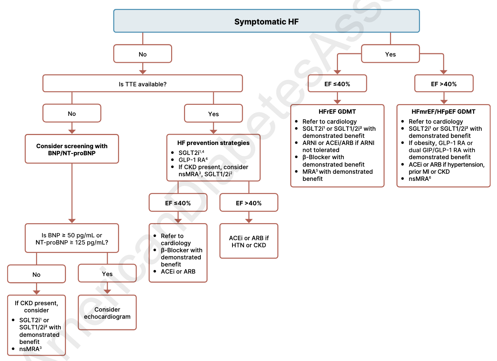
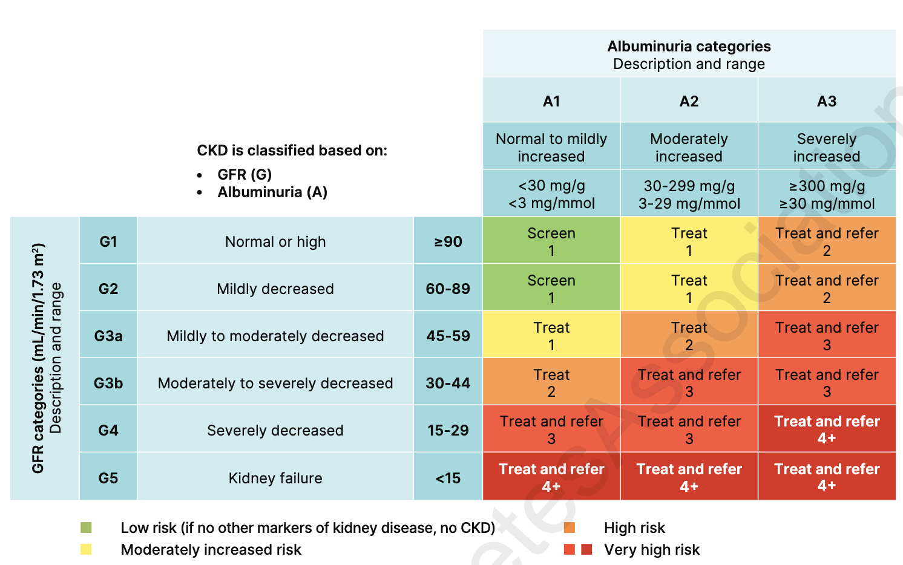
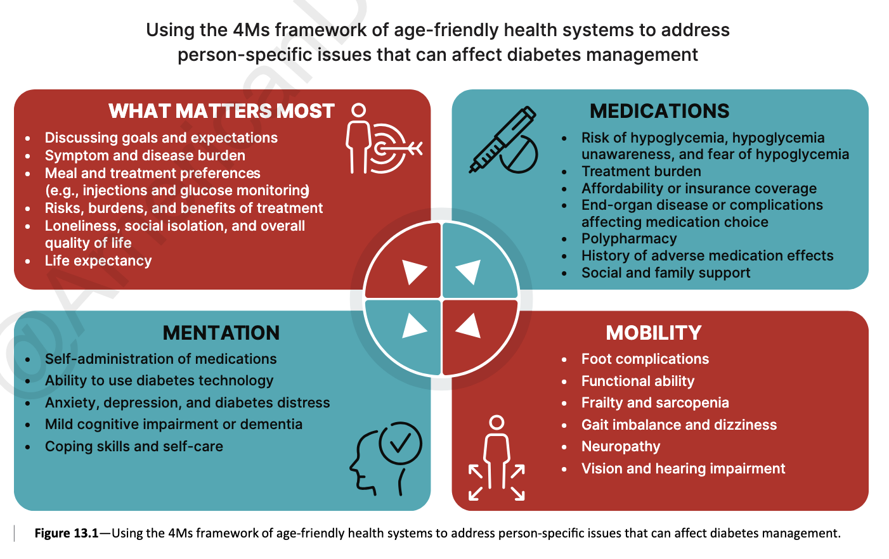
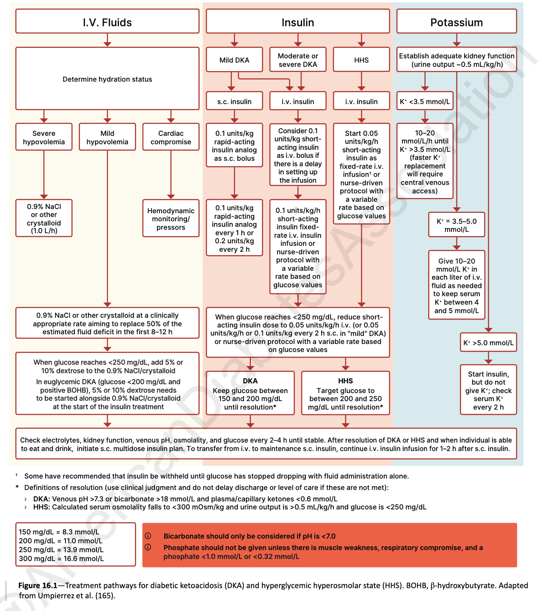

## Section 2: Diagnosis and Classification of Diabetes
### Definitions
**Table 2.1—Criteria for the diagnosis of diabetes in nonpregnant individuals**[@ADA_2026]
| Test | Criterion | Notes |
|---|---|---|
| A1c | ≥6.5% (≥48 mmol/mol) | Lab must be NGSP certified and standardized to the DCCT assay |
| Fasting Plasma Glucose (FPG) | ≥126 mg/dL (≥7.0 mmol/L) | Fasting (8hr)|
| 2-h OGTT | ≥200 mg/dL (≥11.1 mmol/L) | 75 g anhydrous glucose dissolved in water |
| Random plasma glucose | ≥200 mg/dL (≥11.1 mmol/L) | Only helpful in an individual with classic symptoms of hyperglycemia or hyperglycemic crisis|

Note: FPG, fasting plasma glucose; OGTT, oral glucose tolerance test; NGSP, National Glycohemoglobin Standardization Program; WHO, World Health Organization.

**Table 2.2—Criteria defining [Prediabetes](prediabetes.md) in nonpregnant individuals** [@ADA_2026]

Any one of the following:

| Test | Criterion |
|---|---|
| A1C | 5.7–6.4% (39–47 mmol/mol) |
| FPG | 100 mg/dL (5.6 mmol/L) to 125 mg/dL (6.9 mmol/L) (IFG) |
| 2-h OGTT | 140 mg/dL (7.8 mmol/L) to 199 mg/dL (11.0 mmol/L) (IGT) |

Note: **A1C may not be always be reliable**
    - “A1C is an indirect measure of glucose exposure, and factors that affect hemoglobin concentrations or erythrocyte turnover can affect A1C (e.g., thalassemia or folate deficiency) (Table 2.3). **A1C may not be a suitable diagnostic test in people with anemia, people treated with erythropoietin, or people undergoing hemodialysis or HIV treatment.**” [@ADA_2026, p. 529]

### Screening
**Table 2.5—Criteria for screening for diabetes or prediabetes in asymptomatic adults**[@ADA_2026]

1. **adults with overweight or obesity (BMI ≥25 kg/m²)** w/ risk factors:
    - FHx DM. ==Screen all people w/ FHx of [T1DM](type-1-diabetes-mellitus.md) or other known genetic risk w/ IA, GAD, IA-2 and ZnT8==
    - High-risk race, ethnicity, and ancestry (e.g., African American, Latino, Native American, Asian American)
    - Hx CVD
    - [Hypertension](../../cardiovascular-medicine/hypertension/hypertension.md)
    - [Dyslipidemia](../../cardiovascular-medicine/hyperlipidemia/dyslipidemia.md)
    - [PMOS](../metabolic-disorders/polyendocrine-metabolic-ovarian-syndrome.md)
    - Physical inactivity
    - Other clinical conditions associated with insulin resistance (e.g., severe obesity, acanthosis nigricans, [MASLD](../../gastroenterology/liver/metabolic-associated-steatotic-liver-disease.md))
2. **People with prediabetes** (A1C ≥5.7% [≥39 mmol/mol], IGT, or IFG) should be tested yearly.
3. If **diagnosed with [GDM](gestational-diabetes.md)** test q1–3 years.
4. All others start at age 35
5. If normal, repeat at least **q3yrs**.

Note: GDM, gestational diabetes mellitus; IFG, impaired fasting glucose; IGT, impaired glucose tolerance.

### Diagnosis
- Confirmatory tests are necessary to establish the diagnosis in the absence of clear clinical signs.  **Either 2 tests @ same time, or same test two different times**

### Classification
#### Type 1 DM = Autoimmune B-cell destruction
- Most useful features: Age <35; BMI <25; Unintentional weight loss; Ketoacidosis; Plasma glucose >360 mg/dL
- **Stage 1**: Normoglycemia, non symptomatic
- **Stage 2**: **Dysglycemia**; non symptomatic; 
- **Stage 3**: Overt hyperglycemia; **symptomatic** 

#### Prediabetes and [Type 2 DM](type-2-diabetes-mellitus.md) 
- non autoimmune progressive loss of adequate B cell insulin secretion

#### Gestational DM
- Impaired insulin sensitivity during pregnancy

#### Medication Induced Diabetes (esp long term use of glucocorticoids and antipsychotics)
- Glucocorticoids ≥ 5mg prednisolone: Screen *random* glucose rather than fasting. Check glucose twice weekly. 
- Antipsychotics: screen @ initation, 3mo later, and annually

#### People living with HIV
- Test annually using *plasma glucose* as A1c may be incorrect. 

#### Pancreatic Diabetes (CF, post acute or chronic pancreatitis)
- Screen annually. For CF use OGTT

#### Posttransplant DM
- OGTT should be done after on stable immunosuppressive plan and w/o active infection 

## Section 3: Prevention or delay of DM and associated comorbidities
- Prediabetes: test annually
- T1DM
  - Stage 1: A1c every 6mo + 75g OGTT annually (fasting + 2 hr plasma glucose). 
  - New medications avaiable to delay progression to stage 3 - refer to endo. 
- T2DM: Diabetes Prevention Program + Pharmacologic interventions to preserve B cell function

## Section 4: Comprehensive Medical Evaluation and Assessment of Comorbidities
**Table 4.1—Components of the comprehensive diabetes medical evaluation at initial, follow-up, and annual visits** [@ADA_2026]

| Component | Initial visit | Every follow-up | Annual |
|---|:-:|:-:|:-:|
| **Past medical and family history** |  |  |  |
| *Diabetes history* |  |  |  |
| Age and symptoms @ onset | ✓ |  |  |
| Review previous treatment plans| ✓ |  |  |
| Assess past hospitalizations | ✓ |  |  |
| *Family history* |  | |  |
| FHx of diabetes in a first-degree relative | ✓ |  |  |
| FHx of autoimmune disorders | ✓ |  |  |
| *Personal history of complications and common comorbidities* |  |  |  |
| Common comorbidities (e.g., obesity, OSA, and MASLD) | ✓ |  | ✓ |
| ⬆BP or abnormal lipids | ✓ |  | ✓ |
| Macrovascular and microvascular complications | ✓ |  | ✓ |
| Hypoglycemia: awareness, frequency, causes, and timing of episodes | ✓ | ✓ | ✓ |
| Hemoglobinopathies or anemias | ✓ |  | ✓ |
| Last dental visit | ✓ |  | ✓ |
| Last foot exam | ✓ |  | ✓ |
| Last dilated eye exam | ✓ |  | ✓ |
| Visits to specialists | ✓ |  |  |
| Disability assessment and use of assistive devices (e.g., physical, cognitive, vision and auditory, history of fractures, and podiatry) | ✓ | ✓ | ✓ |
| Hx of autoimmune disease | ✓ |  |  |
| *Surgical and procedure history* |  |  |  |
| Surgeries (e.g., metabolic surgery and transplantation) | ✓ | ✓ | ✓ |
| *Interval history* |  |  |  |
| Changes in MHx or FHx |  | ✓ | ✓ |
| *Behavioral factors* |  |  |  |
| Physical activity, sleep behaviors, eating patterns and weight history | ✓ | ✓ | ✓ |
| Assess familiarity with carbohydrate counting (e.g., type 1 diabetes or type 2 diabetes treated with MDI) | ✓ |  | ✓ |
| Screen for OSA | ✓ | ✓ | ✓ |
| Substance Use | ✓ | ✓ | ✓ |
| *Medications and vaccinations* |  |  |  |
| Current medication plan | ✓ | ✓ | ✓ |
| Medication-taking behavior, including rationing of medications and/or medical equipment | ✓ | ✓ | ✓ |
| Medication intolerance or side effects | ✓ | ✓ | ✓ |
| CAM use | ✓ | ✓ | ✓ |
| Vaccination history and needs | ✓ |  | ✓ |
| *Technology use* |  |  |  |
| Assess use of health apps, online education, patient portals, etc. | ✓ | ✓ | ✓ |
| Glucose monitoring (meter/CGM): results and data use | ✓ | ✓ | ✓ |
| Review insulin pump settings and use and connected pen and glucose data | ✓ | ✓ | ✓ |
| *Social life assessment* |  |  |  |
| *Social network* |  |  |  |
| Identify existing social supports | ✓ |  | ✓ |
| Identify surrogate decision maker and advanced care plan | ✓ |  | ✓ |
| Identify SDoH | ✓ |  | ✓ |
| Assess daily routine and ability to engage in diabetes self-management | ✓ | ✓ | ✓ |
| **Physical examination** |  |  |  |
| Height, weight, and BMI; growth and pubertal development in children and adolescents | ✓ | ✓ | ✓ |
| Blood pressure | ✓ | ✓ | ✓ |
| Orthostatic BP (when indicated) | ✓ |  | ✓ |
| Fundoscopic examination (refer to eye specialist) | ✓ |  | ✓ |
| Thyroid palpation | ✓ |  | ✓ |
| Skin examination (e.g., acanthosis nigricans, insulin injection or insertion sites, and lipodystrophy) | ✓ | ✓ | ✓ |
| Comprehensive foot examination, determination of temperature, vibration or pinprick sensation, and 10-g monofilament exam | ✓ |  | ✓ |
| Foot Visual inspection (e.g., skin integrity, callous formation, foot deformity or ulcer, and toenails)\* | ✓ | ✓ | ✓ |
| Check pedal pulses and screen for PAD with ABI testing if a PAD diagnosis would change management | ✓ |  | ✓ |
| Screen for depression, anxiety, diabetes distress, fear of hypoglycemia, and disordered eating | ✓ |  | ✓ |
| Cognitive performance | ✓ |  | ✓ |
| Functional performance | ✓ |  | ✓ |
| Assessment for bone health (e.g., loss of height and kyphosis) | ✓ |  | ✓ |
| **Laboratory evaluation** |  |  |  |
| A1c | ✓ | ✓ | ✓ |
| Lipid profile | ✓ |  |  |
| LFTs (i.e., FIB-4)‡ | ✓ |  | ✓ |
| Urinary albumin-to-creatinine ratio | ✓ |  | ✓ |
| Serum Cr and eGFR | ✓ |  | ✓ |
| TSH (T1DM only) | ✓ |  | ✓ |
| Celiac disease screening in people with type 1 diabetes | ✓ |  |  |
| Vitamin B12 if taking metformin for >5 years | ✓ |  | ✓ |
| CBC with platelets | ✓ |  | ✓ |
| Serum potassium levels in people treated with ACE inhibitors, ARBs, or diuretics§ | ✓ |  | ✓ |
| Calcium, vitamin D, and phosphorous as appropriate | ✓ |  | ✓ |

Note: ABI, ankle brachial index; CAM, Complementary and alternative medicine; FIB-4, fibrosis-4 index; MDI, multiple daily injections; \*Should be performed at every visit in people with diabetes with sensory loss, previous foot ulcers, or amputations. †At 65 years of age or older.

**Table 4.2—Essential components for assessment, planning, and referral** [@ADA_2026]

- **Assessing risk of diabetes complications**
  - ASCVD and HF history, risk factors and 10-year ASCVD risk score
  - Stage CKD
  - Assess hypoglycemia risk
  - Assessment for retinopathy
  - Assessment for neuropathy
  - Assessment for MASLD and [MASH](../../gastroenterology/liver/metabolic-dysfunction-associated-steatohepatitis.md)
- **Goal setting**
  - Set A1C, blood glucose, and time-in-range goals
  - Set lipid goal
  - Set blood pressure goal
  - Weight management and physical activity goals
  - Diabetes self-management goals
- **Therapeutic treatment plans**
  - Lifestyle management
  - Pharmacology:
    - Glucose lowering
    - CVD and CKD risk reduction
    - Weight management
  - Use of technology (CGM, AIM)
  - Referral to diabetes education and medical specialists
- **Referrals for initial care management**
  - Eye care
  - Family planning
  - RDN
  - Diabetes self-management education and support
  - Dentistn
  - Behavioral health
  - Audiology
  - Social work
  - Rehabilitation medicine (physical/cognitive disability evaluation)
  
Note: ASCVD, atherosclerotic cardiovascular disease; MASH, metabolic dysfunction-associated steatohepatitis; MASLD, metabolic dysfunction-associated steatotic liver disease.

#### Considerations for Bone Health
- Effect of Diabetes medications on bone metabolism
	- Metformin - neutral
	- DPP4i - neutral 
	- GLP-1 RA - neutral to beneficial at low dose
	- Thiazolidinediones - Double risk w/in 2 years
	- Sulfonylureas - RR 1.30
	- SGLT2i - questionable
	- Insulin - likely due to higher risk of hypoglycemia

## Section 5: Facilitating Positive Health Behaviors and Well-being to Improve Health Outcomes
- **Diabetes self-management education and support**: All diabetics should get Diabetes self-management education (DSME) annually. Medicare reimburses.
- **Diabetes Technology**: Pair w/ DSME. CGMs increase time in range and have greater reduction in A1c compared w/ education alone
- **Medical Nutrition Therapy (MNT)**: Annual MNT is important b/c diabetes is progressive. Covered by Medicare. May reduce A1c up to 2%
- **Religious Fasting**: Use the Diabetes and Ramadan International Alliance risk calculator. Prefasting education -> increase frequency of glucose monitoring, timing of monitoring(last few hours >50% of hypoglycemic events) *See Table 5.4*
- **Physical Activity**
- **Smoking Cessation**: Ask about all types of tobacco use. Educate about the possibility of DKA w/ Cannabis Hyperemesis
- [**Diabetes Psychosocial Care**](https://professional.diabetes.org/sites/default/files/media/ada_mental_health_toolkit_questionnaires.pdf$0)
  - Problem Areas in Diabetes (PAID) scale
  - Diabetes Distress Scale (DDS-17)
  - T1 Diabetes Distress Scale (T1-DDS)
  - Hypoglycemia Fear Survey-II (HFS-II W)
  - Insulin Treatment Appraisal Scale (ITAS)
  - PHQ-9 + GAD-7

**Table 5.4—Changes in medications during fasting** [@ADA_2026]

| Medication name | Risk of hypoglycemia | Timing | Total daily dose |
|---|---|---|---|
| Metformin, SGLT2 inhibitor, DPP-4 inhibitor, GLP-1 receptor agonist, acarbose, or pioglitazone | Low | • Daily, main mealtime. • 2x/day,  split dose. • Weekly, no change. | • No change |
| New generation of sulfonylurea (glimepiride and gliclazide) | Low to moderate | • Daily, main mealtime. • 2x/day, split dose. | • Reduce dose if glucose goal range and no hypo or hyperglycemia. |
| Older generation of sulfonylurea (glyburide) | Moderate to high | • main meal | • Replace with newer-generation sulfonylurea or reduce dose by 50%. |
| Basal insulin | Moderate to high | • For LAA (glargine 300 or degludec), no change. • For others, take at break fast. | • Choose insulin with lower risk of hypoglycemia among the class. • Reduce dose by 25–35% if not well managed. |
| Prandial insulin | High | • At mealtime | • Reduce dose for meal followed by fasting (35–50%). • For other meals, carb cover. |
| Mixed insulin and insulin coformulations | High | • Daily,main mealtime. • 2x/day, split dose  | • Reduce for meal followed by fasting (35–50%). • Other meals, no change. |

Note: DPP-4, dipeptidyl peptidase 4; GLP-1, glucagon-like peptide 1; SGLT2, sodium–glucose cotransporter 2.

## Section 6: Glycemic Goals, Hypoglycemia, and Hyperglycemic Crises
### Assessment of Glycemic Status 
- A1c reflects average glycemia over approximately 2-3 months. Test at least q6mo. 
- CGM is useful in people at risk for hypoglycemia (anyone who uses insulin). > 70% TIR ≈ A1c 7%. 

**Table 6.1—Equivalent A1C levels and estimated average glucose (eAG)** [@ADA_2026]

| A1C (%) | A1C (mmol/mol) | eAG mg/dL\* | eAG mmol/L\* |
|:-:|:-:|:-:|:-:|
| 5 | 31 | 97 (76–120) | 5.4 (4.2–6.7) |
| 6 | 42 | 126 (100–152) | 7.0 (5.5–8.5) |
| 7 | 53 | 154 (123–185) | 8.6 (6.8–10.3) |
| 8 | 64 | 183 (147–217) | 10.2 (8.1–12.1) |
| 9 | 75 | 212 (170–249) | 11.8 (9.4–13.9) |
| 10 | 86 | 240 (193–282) | 13.4 (10.7–15.7) |
| 11 | 97 | 269 (217–314) | 14.9 (12.0–17.5) |
| 12 | 108 | 298 (240–347) | 16.5 (13.3–19.3) |

**Table 6.2—CGM metrics for clinical care in nonpregnant individuals with T1 or T2DM** [@ADA_2026]

| Metric | Interpretation | Goals |
|---|---|---|
| *Metrics for valid CGM wear* | | |
| Wear time | # days CGM is worn | ≥14-day wear for pattern management |
| Active percentage time | % time CGM  is active | 70% per 14 days |
| *Glycemic metrics* | | |
| Mean glucose | Mean of glucose values | \* |
| Glucose management indicator (GMI) | Calculated value approximating A1C (not always equivalent) | \* |
| Glucose coefficient of variation (CV) | Spread of glucose values | ≤36% |
| TAR >250 mg/dL| % time in **level 2 hyperglycemia** | <5% (most adults); <10% (if old/ill) |
| TAR >180 mg/dL | % time in **level 1 hyperglycemia** | <25% (most adults); <50% ((if old/ill) |
| TIR 70–180 mg/dL | % time **in range** | >70% (most adults); >50% (if old/ill) |
| TBR <70 mg/dL | % time in **level 1 hypoglycemia** | <4% (most adults); <1% (if old/ill) |
| TBR <54 mg/dL | % time in **level 2 hypoglycemia** | <1% |

### Glycemic Goals
- A1c <7.0%
- Preprandial plasma glucose 80-130 mg/dL
- Peak postprandial plasma glucose <180mg/dL
### Hypoglycemia assessment, prevention, and treatment
- Definitions:
  - Level 1: 54<= Glucose <70 mg/dL
  - Level 2: Glucose <54
  - Level 3: Severe event requiring assistance
- **Risk Assessment**: Prior Level 2/3 events = strongest risk factors. Meds that cause hypoglycemia: *Insulin, Sulfonylureas, Meglitinides*. Screen for hypoglycemia unawareness (hypoglycemia-associated autonomic failure) annually. "Can you always feel when your BG is low?"
- **Treatment**: 15g fast-acting carbs @ alert value of 70 mg/dL, recheck glucose after 15 mins. Glucagon if needed
- **Prevention**
  - Diabetes Education
  - CGMs
  - Modification of DM treatment during illness
    - Hold Metformin and SGLT2i if not PO or AKI occurs
    - Hold GLP-1s in GI illness
    - Hold sulfonylureas w/ Abx and azoles
  - If hypoglycemic unaware, relax glycemic goals for a few weeks to allow counterregulation to reoccur and support hypoglycemic awareness
### Hyperglycemic Crises (DKA, HHS)
- Risk factors include very-low carb diets, fasting, dehydration, alcohol, and autoimmunity 
- Provide all T1DM and insulin using T2DM w/ ketone tests and educate on ketotic states. Can self manage w/ frequent glucose/ketone monitoring + SQ insulin
## Section 7: Diabetes Technology
### Blood Glucose monitoring and CGMs
- All persons using MDI or pump insulin should be offered a CGM
- Glucose monitors do not work well in the setting of: critical illness, O2 therapy, hypoxia, excessively high or low temps, and some interfering substances

**Table 7.2—Some of the more common interfering substances and/or conditions that affect blood glucose meters (for inpatient and outpatient use)** [@ADA_2026]

| Substance or condition | Potential effects on glucose readings measured by BGMs\* |
|---|---|
| Maltose† | Falsely higher blood glucose readings |
| Galactose | Falsely higher blood glucose readings |
| Xylose | Falsely higher blood glucose readings |
| *N*-Acetylcysteine | Falsely higher or lower blood glucose readings (depending on BGM design) |
| Acetaminophen | Falsely higher or lower blood glucose readings (depending on BGM design) |
| Dopamine | Falsely higher or lower blood glucose readings (depending on BGM design) |
| Pralidoxime (2-PAM) | Falsely higher or lower blood glucose readings (depending on BGM design) |
| Hydroxyurea | Falsely higher or lower blood glucose readings (depending on BGM design) |
| Vitamin C | Falsely higher or lower blood glucose readings (depending on BGM design) |
| Hematocrit (high) | Falsely lower blood glucose readings |
| Hematocrit (low) | Falsely higher blood glucose readings |

**Table 7.4—Continuous glucose monitoring device interfering substances** [@ADA_2026]

| Medication | Systems affected | Effect |
|---|---|---|
| *Acetaminophen* | | |
| >4 g/day | Dexcom G6, Dexcom G7 | Higher sensor readings than actual glucose |
| Any dose | Medtronic Guardian 4 | Higher sensor readings than actual glucose |
| Ascorbic acid (vitamin C), >500 mg/day | FreeStyle Libre 2, FreeStyle Libre 3 | Higher sensor readings than actual glucose |
| Ascorbic acid (vitamin C), >1,000 mg/day | FreeStyle Libre 2 Plus, FreeStyle Libre 3 Plus | Higher sensor readings than actual glucose |
| Hydroxyurea | Dexcom G6, Dexcom G7, Medtronic Guardian 4 | Higher sensor readings than actual glucose |
| Mannitol (intravenously or as peritoneal dialysis solution) | Senseonics Eversense365 | Higher sensor readings than actual glucose |
| Sorbitol (intravenously or as peritoneal dialysis solution) | Senseonics Eversense365 | Higher sensor readings than actual glucose |

### Insulin delivery
- Pens are preferred over syringes. "Connected pens" calculate doses and record them. 
- Inhaled insulin is an option!
- Insulin Pumps - Very successful. Issues = dislodgement, occlusion, lipohypertrophy, and site infection. Will still need to manually enter meal carbs
- In T2DM - patch like insulin delivery works well. 
- Continue CGMs and insulin pump when hospitalized as appropriate

## Section 10: CVD risk managment
- ASCVD-HF-CKD-DM are now called "Cardiorenal metabolic disease"
- ==Treatment including SGLTi and GLP1 is considered a fundamental element of the CVD/CKD risk reduction strategy in DM==
### HTN and BP management 
- Systolic >=130, Diastolic >=80
- May want to consider intensive treatment down to <120/80 for people @ high risk. Data is pretty good that lower BP = lower CVD risk in DM. 
- **Lifestyle management**: Reduce body weight, increase activity, restrict Na+ to <2,300 mg/day, reduce or eliminate EtOH, follow DASH (ehh its fine)
- Pharmacology
	- Initial Treatment: ACE or ARB +/- Thiazide-diuretic +/- CCB.
	- Resistant: Add Spironolactone or eplerenone
	- Monitor K+ and Cr

*Figure 10.2—Recommendations for the treatment of confirmed hypertension in nonpregnant people with diabetes. Source: [@ADA_2026]*

### Lipid Management
- Lifestyle management 
- Primary Prevention:
	- Monitoring: Lipid panel q5 yrs if not on statin, annual if on statin
	- Initiating Statin Therapy: <40 yrs w/o risk use Moderate. >40 yrs or w/ risk use High intensity. Intensification = Add Ezetimide or PCSK9i if needed. 
- Secondary Prevention (established ASCVD): High intensity statins recommended w/Goal LDL <55mg/dL
### Antiplatelet Agents
- Asprin - 81 mg seems fine
	- 1ª prevention: DM + age >50 + one other risk factor and NOT at risk of bleeding. Stop use when >70 yrs
	- 2ª prevention: USE IT
      - **Aspirin + Clopidogrel (or Ticagrelor)**: After ACS w/ revascularization or Stroke
      - **Aspirin + Rivaroxaban** 2.5 mg: Stable Coronary/PA disease
## Cardiovascular Disease
- ASCVD
	- If symptoms + abnormal EKG -> Stress EKG +/-ECHO
		- CAC to guide risk assessment
	- Do not screen asymptomatic individuals

*Prevention of ASCVD in people with type 2 diabetes. Source: [@ADA_2026]*

- HF
	- Screen Asymptomatic T2DM w/ BNP. If >=50 pg/mL high risk
	- Screen Asymptomatic T1DM w/ NT-proBNP. If >= 125 pg/mL
		- Remember CKD, Pulm HTN, COPD, OSA, Stroke, and anemia can raise levels.
	- If (+) get an ECHO

*Screening and treatment of heart failure in people with diabetes. Source: [@ADA_2026]*

- PAD
	- Symptoms of claudication are uncommon. 
	- Screen using ==Ankle-Brachial Index== if pt >65, DM for >10yrs, microvascular disease, foot issues, or any end organ damage
#### Cardiac Interventions
- Statin + ACEi or ARB +/- Aspirin
- ==GLP1== and ==SGLT2i== are great drugs to have them on
- ==Finerenone== - a nsMRA - recommended for people w/ T2DM and CKD to prevent HF
- If HF is symptomatic follow GDMT, using Finerenone as MRA
## Section 11: CKD risk management
### Assess Albuminuria and eGFR

*CKD classification by GFR and albuminuria categories. Source: [@ADA_2026]*

- Check Ur Albumin/Cr and eGFR annually. If abnormal check again in 3 mo, if still abnormal then consider person to have moderate/severely elevated albuminuria. 
	- eGFR <60 +/- Ur Albumin/Cr >30 = abnormal
	- @ any eGFR, degree of albuminuria = risk of CVD

### Prevention
- 1ª Prevention: Only A1c <7% and BP <130/80 helps. Use of ACE/ARB doesn't do much
- 2ª Prevention: Simultaneous initiation of SGLT2i and nsMRA (finerenone) should be considered in T2DM w/ Urine Albumin/Cr >=100 w/ eGFR 30-90 on ACE/ARB

*Holistic approach to reducing kidney and cardiovascular risk in people with diabetes and CKD. Source: [@ADA_2026]*

## Section 12: Retinopathy, Neuropathy, and Foot Care
- Diabetic Retinopathy -> Diabetic Macular Edema or retinal detachment.
	- DR is the most frequent cause of blindness in adults 20-80yrs
	- Retinal photography allows for distance screening for DR.
	- Screening should occur every 3 yrs. 
- Neuropathy -> ulcers -> amputation
	- ==Peripheral Neuropathy==: Screen w/ annual monofilament testing and vibration sensing
	- ==Autonomic neuropathy:== Screen by asking about orthostatic dizziness, syncope, ED, changes in sweating patterns. Resting Tachycardia, Orthostatic Hypotension, gastroparesis, incontinence, and evidence of peripheral dry skin support diagnosis 
	- ==Cardiovascular Autonomic Neuropathy:== Decreased HRV w/ deep breathing -> resting tachycardia + orthostatic hypotension
	- ==Gastrointestinal Neuropathy==: Consider effect of medications and peptic ulcer disease. Test for gastroparesis w/ gastric scintigraphy or 13C Octanoic acid breath test. 
	- ==GU disturbances:==  Sexual and bladder dysfunction
- Treatment
	- Glycemic Management
	- Weight Management
	- Lipid Management - especially in T2DM
	- BP Management 
	- Neuropathic Pain Management: 1st line = TCAs (amitriptyline) or SNRIs (duloxetine) +/- gabapentinoids; 2nd line = Na channel blockers (lamotrigine, lacosamide, carbamazepine, oxcarbazepine, valproic acid), Capsaicin 8% patch, Lidocaine 5% patch (much less effective); 3rd Line = Tramadol (unfavorable side effects) or Tapentadol (same)
	- Orthostatic Hypotension Management: Goal = minimize the postural symptoms. Is challenging.
	- Gastroparesis Management: Eat small particles. ==Metoclopramide== has weak efficacy. 
	- Erectile Dysfunction: PPD5i + treatment of hypogonadism if exists
- Foot Care
	- Examine skin integrity, Loss Of Protective Sensation (LOPS) using monofilament, pulse exam, and assessment for deformities (bunions, hammertoes, prominent metatarsals)
	- If PAD possible refer or Arterial doppler US w/ pulse volume recordings. Toe systolic BP is more accurate than ankle in DM. If <30 then suggestive of PAD. Screen starting @ 50 and every 5 years after. 

**Table 12.1—International Working Group on Diabetic Foot risk stratification system and corresponding foot screening frequency** [@ADA_2026]

| Category | Ulcer risk | Characteristics | Examination frequency\* |
|:-:|---|---|---|
| 0 | Very low | No LOPS and no PAD | Annually |
| 1 | Low | LOPS or PAD | Every 6–12 months |
| 2 | Moderate | LOPS + PAD, or LOPS + foot deformity, or PAD + foot deformity | Every 3–6 months |
| 3 | High | LOPS or PAD and one or more of the following: • History of foot ulcer • Amputation (minor or major) • Kidney failure | Every 1–3 months |

## Section 13: Older Adults w/DM

*Figure 13.1—Using the 4Ms framework of age-friendly health systems to address person-specific issues that can affect diabetes management. Source: [@ADA_2026]*

- Assess all geriatric syndromes annually for age >65 
	- Cognitive impariment - Mini Cog
	- Delirium - 4AT
	- Depression - GDS-5
	- Falls - STEADI tool
	- Frailty - Clinical Frailty Scale
	- Malnutrition - Mini Nutritional Assessment SF
	- Pain - Numeric Pain Rating Scale
	- Polypharmacy - Beers Criteria
	- Sarcopenia - SARC-F
	- Hearing Impairment - Whisper Test
	- Vision Impairment - Snellen Chart
	- Insomnia - Insomnia Severity Index 7
	- Urinary Incontinence - 3 Incontinence Questions
	- Reduced Dexterity - Button and coin test
	- Dizziness - Orthostatic vital signs, neuro exam
	- Reduced Executive Functioning - Trail making test B

**Table 13.2—Framework for considering treatment goals for glycemia, blood pressure, and dyslipidemia in older adults with diabetes** [@ADA_2026]

| Characteristics and health status of person with diabetes | Rationale | Reasonable A1C goal\* | Reasonable CGM goals | Fasting or preprandial glucose | Bedtime glucose | Blood pressure | Lipids |
|---|---|---|---|---|---|---|---|
| Healthy (few coexisting chronic illnesses, intact cognitive and functional status) | Longer remaining life expectancy | <7.0–7.5% (<53–58 mmol/mol) | TIR 70–180 mg/dL (3.9–10.0 mmol/L) of ≥70%, and TBR ≤70 mg/dL (≤3.9 mmol/L) of ≤4% | 80–130 mg/dL (4.4–7.2 mmol/L) | 80–180 mg/dL (4.4–10.0 mmol/L) | <130/80 mmHg | Statin, unless contraindicated or not tolerated |
| Complex/intermediate (multiple coexisting chronic illnesses† or two or more ADL impairments or mild to moderate cognitive impairment) | Variable life expectancy. Individualize goals, considering: • Severity of comorbidities • Cognitive and functional limitations • Frailty • Risk-to-benefit ratio of diabetes medications • Individual preference | <8.0% (<64 mmol/mol) | TIR 70–180 mg/dL (3.9–10.0 mmol/L) of ≥50% and TBR <70 mg/dL (<3.9 mmol/L) of <1% | 90–150 mg/dL (5.0–8.3 mmol/L) | 100–180 mg/dL (5.6–10.0 mmol/L) | <130/80 mmHg | Statin, unless contraindicated or not tolerated |
| Very complex/poor health (PALTC or end-stage chronic illnesses‡ or moderate to severe cognitive impairment or two or more ADL impairments) | Limited remaining life expectancy makes benefit minimal | Avoid reliance on A1C; glucose management decisions should be based on avoiding hypoglycemia and symptomatic hyperglycemia | | 100–180 mg/dL (5.6–10.0 mmol/L) | 110–200 mg/dL (6.1–11.1 mmol/L) | <140/90 mmHg | Consider likelihood of benefit with statin |

Note: This table represents a consensus framework for considering treatment goals for glycemia, blood pressure, and dyslipidemia in older adults with diabetes. The characteristic categories are general concepts. Not every individual will clearly fall into a particular category. Consideration of individual and care partner preferences, care partner engagement, abilities, and resources is an important aspect of treatment individualization. Additionally, an individual’s health status and preferences may change over time. ADL, activities of daily living; CGM, continuous glucose monitoring; PALTC, post-acute and long-term care; TBR, time below range; TIR, time in range. \*A lower A1C goal may be set for an individual if achievable without recurrent or severe hypoglycemia or undue treatment burden. †Coexisting chronic illnesses are conditions serious enough to require medications or lifestyle management and may include arthritis, cancer, heart failure, depression, emphysema, falls, hypertension, incontinence, stage 3 or worse chronic kidney disease, myocardial infarction, and stroke. “Multiple” means at least three, but many individuals may have five or more (193). ‡The presence of a single end-stage chronic illness, such as stage 3–4 heart failure or oxygen-dependent lung disease, chronic kidney disease requiring dialysis, or uncontrolled metastatic cancer, may cause significant symptoms or impairment of functional status and significantly reduce life expectancy. Adapted from Kirkman et al. (5).

- Consider Simplification as people age +/- functional status becomes more difficult

| Status                         | Goal                                          | Rationale                                                                           | Simplify?                                                                | Deintensify?                                       |
| ------------------------------ | --------------------------------------------- | ----------------------------------------------------------------------------------- | ------------------------------------------------------------------------ | -------------------------------------------------- |
| Healthy                        | <7-7.5                                        |                                                                                     | 1. Hypoglycemia; 2. Decline following illness                            | 1. Hypoglycemia; 2. Polypharmacy                   |
| Complex or Intermediate health | <8                                            | Comorbidities may affect self-management                                            | 1. Hypoglycemia; 2. Difficulty managing plan; 3. Change in circumstances | 1. Hypoglycemia; 2. Polypharmacy                   |
| SNF dwelling                   | No A1c; Fasting Glucose <200                  | Glycemic management is important for healing                                        | Consider return to home plan                                             | Weightloss, anorexia, short term cognitive decline |
| Poor Health                    | Avoid hypoglycemia, symptomatic hyperglycemia | No benefits of control. Most important outcomes are cognitive and functional status | Inconsistent eating pattern. The individual wants to.                    | Taking med w/o clear benefits                      |
| End of life                    | Avoid hypoglycemia, symptomatic hyperglycemia | Goal is to provide comfort and to avoid all tasks that cause pain/discomfort        | Pain or discomfort. Stress to care partners                              | Taking med w/o clear benefit                       |

*Figure 13.3—Algorithm to simplify insulin administration plans in older individuals. Source: [@ADA_2026]*

## Section 14: Children and Adolescents

*Figure 14.1—Management of new-onset diabetes in youth with overweight or obesity with clinical suspicion of type 2 diabetes. Source: [@ADA_2026]*

## Section 15: DM and Pregnancy

## Section 16: Diabetes in the Hospital 
### DKA and HHS

**Table 16.1—Diagnostic criteria for DKA and HHS** [@ADA_2026]

| Criterion | Definition |
|---|---|
| ***DKA*** | |
| Diabetes/hyperglycemia | Glucose ≥200 mg/dL (11.1 mmol/L) or prior history of diabetes |
| Ketosis | β-Hydroxybutyrate concentration ≥3.0 mmol/L or urine ketone strip 2+ or greater |
| Metabolic acidosis | pH <7.3 and/or bicarbonate concentration <18 mmol/L |
| ***HHS*** | |
| Hyperglycemia | Plasma glucose ≥600 mg/dL (33.3 mmol/L) |
| Hyperosmolarity | Calculated effective serum osmolality >300 mOsm/kg (calculated as [2 × Na⁺ (mmol/L) + glucose (mmol/L)] or total serum osmolality >320 mOsm/kg [2 × Na⁺ (mmol/L) + glucose (mmol/L) + urea (mmol/L)] |
| Absence of significant ketonemia | β-Hydroxybutyrate concentration <3.0 mmol/L OR urine ketone strip less than 2+ |
| Absence of acidosis | pH ≥7.3 and bicarbonate concentration ≥15 mmol/L |

Note: Adapted from Umpierrez et al. (165).

*Figure 16.1—Treatment pathways for diabetic ketoacidosis (DKA) and hyperglycemic hyperosmolar state (HHS). Source: [@ADA_2026]*

## Section 17: Diabetes Advocacy

## Notes

> **Example: Further Reading**
“51. Phillip M, Achenbach P, Addala A, et al. Consensus guidance for monitoring individuals with islet autoantibody-positive pre-stage 3 type 1 diabetes. Diabetes Care 2024;47:1276–1298”
