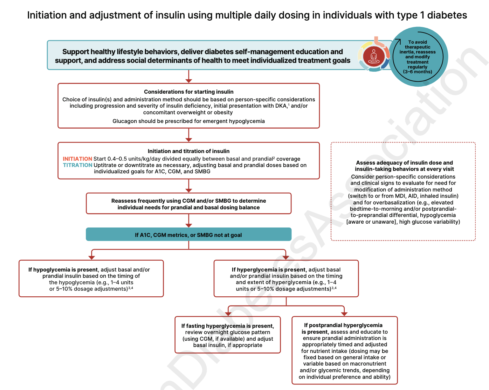

## Classification [@ADA_2026]
- **Stage 1**: Normoglycemia, non symptomatic; **2+ autoantibodies**. 5yr risk ~44%. ==Screen all people w/ FHx of T1DM or other known genetic risk w/ IA, GAD, IA-2 and ZnT8==
  - Free Screening https://www.askhealth.org
  - Children: Test 4 islet autoabs + random glu + A1c. 
    - ≦ 3yrs: Q6mo for 3 yrs then annually for 3 yrs
    - 3-18 yrs: Annually for 3 yrs. Discontinue if no dysglycemia or seroconversion.
  - Adults: Test 4 islet autoabs + random glu + A1c Q3yr OR annual if additional risk. 
- **Stage 2**: **Dysglycemia**; non symptomatic; Multiple autoantibodies. 5yr risk 75%
- **Stage 3**: Overt hyperglycemia; **symptomatic** May lose autoantibodies (b/c B cells are dead). 

## Comprehensive Medical Evaluation and Assessment of Comorbidities
### Autoimmune Disease
- All autoimmune diseases are more common w/ T1DM
- Screen for Thyroid and Celiac disease. - Check B12 if peripheral neuropathy or unexplained anemia
### Bone Health
- DEXA for all >= 50
- General Recommendations
  - Ensure adequate intake of protein, Ca2+ (1000-1200 mg), D (serum levels 20-30 mg/mL; greater if taking bisphosphonates)
  - Stop smoking
  - Regular physical activity
- Pharmacological treatment: Consider if *T-score <-2, FRAX >= 3% for hip or 20% for major fracture*
	-  **Denosumab** - shown in phase 3 FREEDOM study to be efficacious. MUST be able to maintain the every 6 mo injection or may experience rebound bone loss. 
	- **Bisphosophonates** - may be more appropriate if treatment gaps are expected 
	- **Teriperatide** - Osteoanabolic. Only for very high risk
### Cancer
- ⬆ risk of liver, pancreas, endometrium, colon, rectum, breast, and bladder cancers
- Undergo age appropriate screenings
### Cognitive Impairment/Dementia
- Significantly increased risk and rate of cognitive decline
### Dental Care
- Periodontal disease is more severe
- Discuss oral health with all diabetics
- May need to adjust therapy during dental procedures
### Disability
- Assess for disability and functional decline annually (ADLs and IADLs)
- Assess for  [Frailty](../../geriatric-medicine/frailty.md) annually
- Behavioral Health -  Anxiety, Depression, [Diabetes Distress Scale](https://www.mdcalc.com/calc/10523/diabetes-distress-scale-dds17$0) (DDS) 
### Sexual Health in Men
- Screen for erectile dysfunction (52.5%). Treat w/ PDE5i
- Hypogonadism is common
### Sexual Health in Women
-  Female sexual dysfunction is very common - consider screening with the [Female Sexual Function Index (FSFI)](https://www.apta.org/contentassets/a10dbafd45234c7a98ae3dd98385cdab/fsfi_test.pdf$0). Score ≤ 26 is (+) 
- Treatment -> Lifestyle factors, improve glycemic management, hormonal therapies, consider FDA-approved meds for hypoactive sexual desire disorder
### Obstructive Sleep Apnea
- Rates are likely very high in DM + Obesity
- Refer for sleep study if indicated
### Pancreatitis
- Twice as likely in people w/ diabetes
### Sensory Impairment
- Hearing impairment 2x nondiabetic population

## Glycemic Goals, Hypoglycemia, and Hyperglycemic Crises
### Glycemic Goals
- A1c <7.0%
- Preprandial plasma glucose 80-130 mg/dL
- Peak postprandial plasma glucose <180mg/dL
### Hypoglycemia assessment, prevention, and treatment
- Definitions:
  - Level 1: 54<= Glucose <70 mg/dL
  - Level 2: Glucose <54
  - Level 3: Severe event requiring assistance
- **Risk Assessment**: Prior Level 2/3 events = strongest risk factors. Meds that cause hypoglycemia: *Insulin, Sulfonylureas, Meglitinides*. Screen for hypoglycemia unawareness (hypoglycemia-associated autonomic failure) annually. "Can you always feel when your BG is low?"
- **Treatment**: 15g fast-acting carbs @ alert value of 70 mg/dL, recheck glucose after 15 mins. Glucagon if needed
- **Prevention**
  - Diabetes Education
  - CGMs
  - Modification of DM treatment during illness
    - Hold Metformin and SGLT2i if not PO or AKI occurs
    - Hold GLP-1s in GI illness
    - Hold sulfonylureas w/ Abx and azoles
  - If hypoglycemic unaware, relax glycemic goals for a few weeks to allow counterregulation to reoccur and support hypoglycemic awareness
### Hyperglycemic Crises (DKA, HHS)
- Risk factors include very-low carb diets, fasting, dehydration, alcohol, and autoimmunity 
- Provide w/ ketone tests and educate on ketotic states. Can self manage w/ frequent glucose/ketone monitoring + SQ insulin

## Pharmacology for Glycemic Control in T1DM

*Initiation and adjustment of insulin using multiple daily dosing in individuals with type 1 diabetes. Source: [@ADA_2026]*

- Better glycemic control = less microvascular events
- ==Insulin Replacement Plans== = ==Basal insulin== (30-50%) + ==mealtime insulin== (remainder)+ ==correction insulin==
	- Total daily Insulin = 0.5units/kg/day is starting dose
	- Basal insulin = Long Acting Analogue (LAA)
- Non-insulin treatments
  - Pramlintide - amylin analogue
  - Liraglutide
  - SGLT2i 
  - Pancreas/Islet Transplantation

**Table 9.1—Examples of subcutaneous insulin treatment plans** [@ADA_2026]

| Plans | Timing and distribution | Advantages | Disadvantages | Adjusting doses |
|---|---|---|---|---|
| ***Plans that mimic normal insulin secretion*** | | | | |
| ==Insulin pump therapy== | **Basal delivery** of ==URAA or RAA; generally 30–50% of TDD.== **Mealtime and correction**: ==URAA or RAA by bolus==  ∼15 min before eating. | - Can adjust basal rates (sensitivity, exercise, sick days).  - Flexibility in meal timing and content.  - Can integrate with CGM.  TIR % highest and TBR % lowest with: hybrid closed-loop > low-glucose suspend > sensor-augmented open-loop > conventional CSII. | - $$$ - Most complex - Must wear devices.  Risks: Rapid DKA when insulin is interrupted; adhesive reactions; site infections. | ==Mealtime insulin==: if carbohydrate counting is accurate, change ICR if glucose after meal consistently out of target. ==Correction insulin==: adjust ISF and/or target glucose if correction does not consistently bring glucose into range. ==Basal rates==: adjust based on overnight, fasting or daytime glucose outside of activity of URAA/RAA bolus.|
| ==MDI==: LAA + flexible doses of URAA or RAA at meals | ==LAA once daily==  generally 30–50% of TDD. ==Mealtime and correction:== URAA or RAA based on ICR and/or ISF and target glucose. | - Can use pens for all components. - Flexibility in meal timing and content. - Insulin analogs cause less hypoglycemia than human insulins. | - 4+ daily injections. - Most costly insulins. - LAAs may not cover strong dawn phenomenon (rise in glucose in early morning hours) as well as pump therapy. | ==Mealtime insulin==: if carbohydrate counting is accurate, change ICR if glucose after meal consistently out of target. ==Correction insulin==: adjust ISF and/or target glucose if correction does not consistently bring glucose into range. ==LAA==: based on overnight or fasting glucose or daytime glucose outside of activity time course, or URAA or RAA injections. |
| ***MDI plans with less flexibility*** | | | | |
| ==Four injections/day w/ fixed dose N and RAA== | **Pre-breakfast**: RAA ∼20% TDD. **Pre-lunch**: RAA ∼10%TDD. **Pre-dinner**: RAA ∼10% TDD. **Bedtime**: N ∼50% TDD. | - Use if==unable to carbohydrate count==. - All meals have RAA coverage. - N is less expensive than LAAs. | - Shorter duration RAA may lead to basal deficit during day; may need 2x/day N. - Greater risk of nocturnal hypoglycemia with N. - Requires relatively consistent mealtimes and carb intake. | **Pre-breakfast RAA**: based on BGM after breakfast or before lunch. **Pre-lunch RAA**: based on BGM after lunch or before dinner. **Pre-dinner RAA**: based on BGM after dinner or at bedtime. **Evening N**: based on fasting or overnight BGM. |
| ==Four injections/day w/ fixed dose N and R== | **Pre-breakfast**: R ∼20% TDD. **Pre-lunch**: R ∼10% TDD. **Pre-dinner**: ∼10% TDD. **Bedtime**: N ∼50% TDD. | - Use if ==unable to carbohydrate count==. - R can be dosed based on ICR and correction. - All meals have R coverage. - Least expensive insulins. | - N ⬆risk noctural hypoglycemia.  - ⬆ risk delayed post-meal hypoglycemia with R. - Requires relatively consistent mealtimes and carbohydrate intake. - R injected 30+ min before meal. | **Pre-breakfast R**: based on BGM after breakfast or before lunch. **Pre-lunch R**: based on BGM after lunch or before dinner. **Pre-dinner R**: based on BGM after dinner or at bedtime. **Evening N**: based on fasting or overnight BGM. |
| ***Plans with fewer daily injections*** | | | | |
| Three injections daily: N + R or N + RAA | **Pre-breakfast**: N ∼40% TDD + R or RAA ∼15% TDD. **Pre-dinner**: R or RAA ∼15% TDD. **Bedtime**: N ∼30% TDD. | - Morning insulins can be mixed in one syringe. - Use if cannot take injection in middle of day. - Morning N covers lunch to some extent. - Same advantages of RAAs over R. - Least (N + R) or less expensive insulins than MDI with analogs. | - ⬆Risk nocturnal hypoglycemia (N); delayed post meal hypoglycemia (R).  - Requires relatively consistent mealtimes and carbohydrate intake. - Coverage of post-lunch glucose often suboptimal. - Inject R 30+ min before meal. | **Morning N**: based on pre-dinner BGM. **Morning R**: based on pre-lunch BGM. **Morning RAA**: based on post-breakfast or pre-lunch BGM. **Pre-dinner R**: based on bedtime BGM. **Pre-dinner RAA**: based on post-dinner or bedtime BGM. **Evening N**: based on fasting BGM. |
| Twice-daily “split-mixed”: N + R or N + RAA| **Pre-breakfast**: N ∼40%TDD + R or RAA ∼15% TDD. **Pre-dinner**: N ∼30% TDD + R or RAA ∼15% TDD.| - Least number of injections.  - Insulins can be mixed in one syringe. - Least (N + R) or less (N + RAA) expensive insulins vs. analogs. - Eliminates need for doses during the day. | - Risk of hypoglycemia in afternoon or middle of night from N. - Fixed mealtimes and meal content. - Coverage of post-lunch glucose often suboptimal. - Difficult to reach targets w/o hypoglycemia.| **Morning N**: based on pre-dinner BGM. **Morning R**: based on pre-lunch BGM. **Morning RAA**: based on post-breakfast or pre-lunch BGM. **Evening R**: based on bedtime BGM. **Evening RAA**: based on post-dinner or bedtime BGM. **Evening N**: based on fasting BGM. |

Note: ICR, insulin-to-carbohydrate ratio; ISF, insulin sensitivity factor; LAA, long-acting analog; MDI, multiple daily injections; N, NPH insulin; R, short-acting (regular) insulin; RAA, rapid-acting analog; URAA, ultra-rapid-acting analog (inhaled insulin may be considered if appropriate). Adapted from Holt et al. (4).
